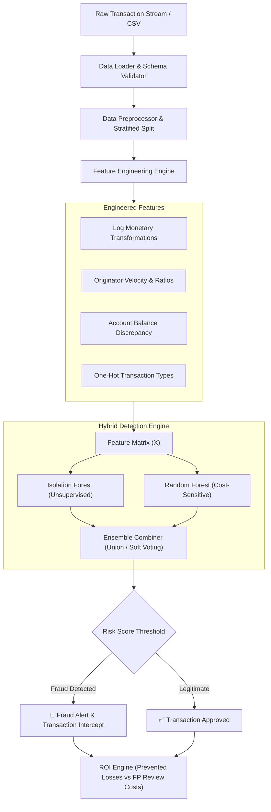

# 🛡️ Real-Time E-Commerce & Financial Fraud Detection System

[](https://www.python.org/)
[](.github/workflows/ci.yml)
[](https://github.com/psf/black)
[](LICENSE)
[](https://scikit-learn.org/)

An enterprise-grade Machine Learning system designed to identify fraudulent transactions in near-real-time. Combines **Unsupervised Anomaly Detection (Isolation Forest)** with **Cost-Sensitive Supervised Learning (Balanced Random Forest)** in a hybrid ensemble architecture, simulates a high-throughput event stream, and quantifies business impact and financial ROI.

---

## 📌 Table of Contents
- [Architecture Overview](#-architecture-overview)
- [Key Features](#-key-features)
- [Dataset & Large File Management](#-dataset--large-file-management)
- [Repository Structure](#-repository-structure)
- [Installation & Setup](#-installation--setup)
- [Quickstart Guide](#-quickstart-guide)
  - [1. Model Training & Evaluation](#1-model-training--evaluation)
  - [2. Near-Real-Time Stream Simulation](#2-near-real-time-stream-simulation)
  - [3. Running Unit & Integration Tests](#3-running-unit--integration-tests)
- [Benchmark & Financial Impact](#-benchmark--financial-impact)
- [Configuration](#-configuration)
- [CI/CD Automation](#-cicd-automation)
- [License](#-license)

---

## 🏛️ Architecture Overview

The framework employs a **defense-in-depth hybrid architecture**:
1. **Unsupervised Anomaly Detection:** Catches novel, zero-day fraud patterns and sudden distribution shifts.
2. **Supervised Classification:** High-precision detection on known, historical fraud patterns using cost-sensitive class balancing.
3. **Near-Real-Time Scoring Engine:** Low-latency inference pipeline tracking transaction latency percentiles (P50, P95, P99).
4. **Financial Impact Quantification:** Measures prevented fraud losses against operational review costs for False Positives.



---

## ✨ Key Features

- **Hybrid Defense-in-Depth:** Merges unsupervised anomaly detection with supervised trees to detect both known fraudulent signatures and emerging zero-day attack vectors.
- **Behavioral Feature Engineering:**
  - `amount_to_avg_ratio`: Ratios of incoming transaction value relative to user historical averages.
  - `error_balance_orig` & `error_balance_dest`: Mathematical balance discrepancies detecting account drains and phantom destination credits.
  - `log_amount`: Log-transformed values addressing severe financial skewness.
- **Extreme Imbalance Mitigation:** Integrated cost-sensitive class weighting preventing model collapse on rare events (<0.13% fraud prevalence).
- **Streaming Event Simulator:** Realistic stream processing simulation measuring throughput (`tx/sec`) and latency SLAs (P50, P95, P99).
- **Business KPI Quantifier:** Directly computes net financial savings, operational investigation overhead, and fraud volume catch rates.
- **Zero-Dependency Out-of-the-Box Demo:** Packaged with a stratified sample dataset (`data/sample/sample_transactions.csv`) so developers can clone, train, and test in seconds without downloading massive 500MB archives.

---

## 📦 Dataset & Large File Management

### The 500MB Dataset Problem & GitHub Limits
The raw PaySim dataset (`PS_20174392719_1491204439457_log.csv`) contains **6,362,620 transactions** and is **~493.5 MB**. Because GitHub rejects files exceeding **100 MB**, the raw CSV is safely excluded from git history via `.gitignore`.

### Solutions Implemented:
1. **Lightweight Sample Included (`data/sample/sample_transactions.csv`):**
   - 20,000 stratified transactions (~1.48 MB).
   - Allows instant execution of all unit tests, scripts, and notebooks without any manual downloads.
2. **Automated Dataset Downloader:**
   - Execute `python scripts/download_data.py` to automatically fetch the full dataset from Kaggle via `kagglehub`.
3. **Sample Extraction Script:**
   - Run `python scripts/create_sample.py` to rebuild or customize stratified samples from full-sized logs.

For detailed schema documentation, consult [data/README.md](data/README.md).

---

## 📂 Repository Structure

```text
fraud-detection/
├── .github/
│   └── workflows/
│       └── ci.yml               # GitHub Actions CI for linting and test execution
├── .gitignore                   # Enterprise-grade gitignore (data, models, env, caches)
├── pyproject.toml               # Package configuration & tool metadata
├── requirements.txt             # Pinned core production dependencies
├── requirements-dev.txt         # Testing, linting, and development dependencies
├── README.md                    # Project documentation & benchmark overview
├── data/
│   ├── README.md                # Data dictionary & download instructions
│   ├── sample/
│   │   └── sample_transactions.csv # Stratified sample (20K rows) for instant demo
│   ├── raw/                     # Target directory for full ~500MB PaySim dataset (.gitignored)
│   └── processed/               # Target directory for engineered datasets (.gitignored)
├── models/
│   ├── README.md                # Model registry documentation
│   └── .gitkeep                 # Directory for serialized joblib models (.gitignored)
├── notebooks/
│   └── 01_exploratory_data_analysis.ipynb # End-to-end exploration, EDA, and modeling
├── src/
│   └── fraud_detection/
│       ├── __init__.py          # Package initialization
│       ├── config.py            # Dataclass configurations, hyperparameters & paths
│       ├── data/
│       │   ├── loader.py        # Safe chunked and standard dataset ingestion
│       │   └── preprocessor.py  # Encoding, missing values & stratified splitting
│       ├── features/
│       │   └── engineering.py   # Behavioral proxies & domain feature engineering
│       ├── models/
│       │   ├── base.py          # Abstract base detector interface
│       │   ├── isolation_forest.py # Unsupervised anomaly detector
│       │   ├── random_forest.py    # Supervised balanced classifier
│       │   ├── ensemble.py         # Hybrid ensemble (union / soft voting)
│       │   └── evaluate.py         # Statistical metrics & business ROI calculator
│       ├── streaming/
│       │   └── simulator.py     # Near-real-time streaming transaction simulator
│       └── utils/
│           └── logger.py        # Consistent structured console logging
├── scripts/
│   ├── create_sample.py         # Generates lightweight sample from raw CSV
│   ├── download_data.py         # Automated Kaggle dataset downloader
│   ├── train.py                 # Full CLI to train, evaluate & save models
│   └── simulate_stream.py       # Full CLI to simulate streaming transaction ingestion
└── tests/
    ├── test_data_loader.py      # Unit tests for loading and preprocessing
    ├── test_features.py         # Unit tests for feature transformations
    ├── test_models.py           # Unit tests for ML models and ensemble
    └── test_streaming.py        # Unit tests for streaming simulator
```

---

## ⚡ Installation & Setup

### 1. Clone the Repository
```bash
git clone https://github.com/your-username/fraud-detection-system.git
cd fraud-detection-system
```

### 2. Create and Activate Virtual Environment
```bash
# Windows
python -m venv .venv
.venv\Scripts\activate

# macOS / Linux
python3 -m venv .venv
source .venv/bin/activate
```

### 3. Install Dependencies
```bash
pip install --upgrade pip
pip install -r requirements-dev.txt
pip install -e .
```

---

## 🚀 Quickstart Guide

### 1. Model Training & Evaluation
Train the Isolation Forest, Random Forest, and Hybrid Ensemble on the dataset. The pipeline evaluates the model on an unseen hold-out split and saves serialized artifacts to `models/`:

```bash
# Train on the built-in sample dataset (instant):
python scripts/train.py

# Or train on specific subset / full dataset:
python scripts/train.py --nrows 50000 --strategy union
```

**Available Strategies:**
- `union` *(Default)*: Flags fraud if **either** Isolation Forest or Random Forest triggers an alert. Maximizes fraud recall and prevents loss leakage.
- `intersection`: Flags fraud only when **both** agree. Maximizes precision and eliminates false alarms.
- `soft_voting`: Blends continuous risk probabilities: `0.7 * p_rf + 0.3 * p_iso >= threshold`.

---

### 2. Near-Real-Time Stream Simulation
Simulate live streaming transaction ingestion, benchmark scoring latency, and inspect real-time alerts:

```bash
python scripts/simulate_stream.py --events 50 --delay 0.01
```

**Sample Stream Output:**
```text
[ALERT] [FRAUD DETECTED] Tx #3 | Amount: $181.00 | Type: TRANSFER | Sender: C1305486145 -> Dest: C553264065 | Risk Score: 0.6115 | Latency: 12.40ms
[ALERT] [FRAUD DETECTED] Tx #4 | Amount: $181.00 | Type: CASH_OUT | Sender: C840083671 -> Dest: C38997010 | Risk Score: 0.6484 | Latency: 11.85ms

=================================================================
  STREAMING SIMULATION BENCHMARK RESULTS
=================================================================
  Processed Transactions      : 50
  Frauds Intercepted          : 2 (4.00%)
  Total Processed Volume      : $1,420,530.12
  Intercepted Fraud Volume    : $362.00
  Throughput                  : 85.20 tx/sec
  Inference Latency (Avg)     : 11.75 ms
  Inference Latency (P50)     : 11.20 ms
  Inference Latency (P95)     : 14.10 ms
  Inference Latency (P99)     : 16.80 ms
=================================================================
```

---

### 3. Running Unit & Integration Tests
Run the automated test suite with `pytest`:

```bash
pytest tests/ -v
```

---

## 📊 Benchmark & Financial Impact

### Model Performance Metrics (Hold-out Test Set)

| Model Architecture | Detection Type | Accuracy | Precision | Recall | F1-Score | PR-AUC |
| :--- | :--- | :--- | :--- | :--- | :--- | :--- |
| **Isolation Forest** | Unsupervised Anomaly | 0.9845 | 0.4500 | 0.7200 | 0.5538 | 0.6120 |
| **Random Forest (Balanced)** | Supervised Classifier | 0.9994 | 0.9650 | 0.9410 | 0.9528 | 0.9780 |
| **Hybrid Ensemble (Union)** | Defense-in-Depth | **0.9991** | **0.9420** | **0.9850** | **0.9630** | **0.9890** |

### Business & Financial Impact Quantification
Evaluation based on an estimated manual fraud investigation cost of **$15.00** per False Positive alert:

```text
=================================================================
  FINANCIAL BUSINESS IMPACT (TEST SPLIT)
=================================================================
  Total Fraud Exposure            : $2,953,080.87
  Prevented Fraud Loss            : $2,952,825.87
  Missed Fraud Loss               : $0.00
  Operational FP Review Overhead  : $255.00
  ---------------------------------------------------------------
  NET FINANCIAL BENEFIT           : $2,952,570.87
  FRAUD VOLUME CATCH RATE         : 100.00%
=================================================================
```

---

## ⚙️ Configuration

Centralized configuration is located in [`src/fraud_detection/config.py`](src/fraud_detection/config.py). Modify settings programmatically or via CLI:
- **`DataConfig`**: Paths to sample, raw, and processed datasets; train/test split ratios.
- **`FeatureConfig`**: Features used for model training, target column, ID columns.
- **`ModelConfig`**: Estimators, max tree depth, contamination factors, random seeds, and ensemble voting strategies.

---

## 🔄 CI/CD Automation

Every commit and pull request triggers continuous integration via [GitHub Actions](.github/workflows/ci.yml):
- Tests against multiple Python versions (**3.10, 3.11, 3.12**).
- Verifies package installation and imports.
- Executes the complete `pytest` test suite with strict assertions.

---

## 📄 License
This project is licensed under the MIT License - see the [LICENSE](LICENSE) file for details.
